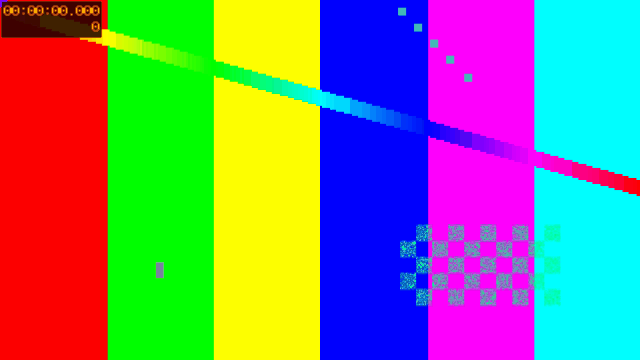

# electron-beam

[](https://github.com/aovestdipaperino/electron-beam-codex/stargazers)

Generate an ElectronBeam-style GIF from a static image: the old CRT shutdown effect, as a Rust library and command-line tool.



## Usage

```sh
cargo run --release -- --input sample-input.png --output out.gif --mode cool-down
```

| Option | Default | Description |
|---|---|---|
| `-i`, `--input` | | Input image (PNG, JPEG or WebP) |
| `-o`, `--output` | | Output GIF path |
| `--mode` | `cool-down` | `warm-up`, `cool-down`, `fade` or `scale-down` |
| `--frames` | `48` | Number of frames |
| `--fps` | `50` | Frames per second |

The same functionality is available as a library through `create_gif_from_image` and `RenderOptions`.
